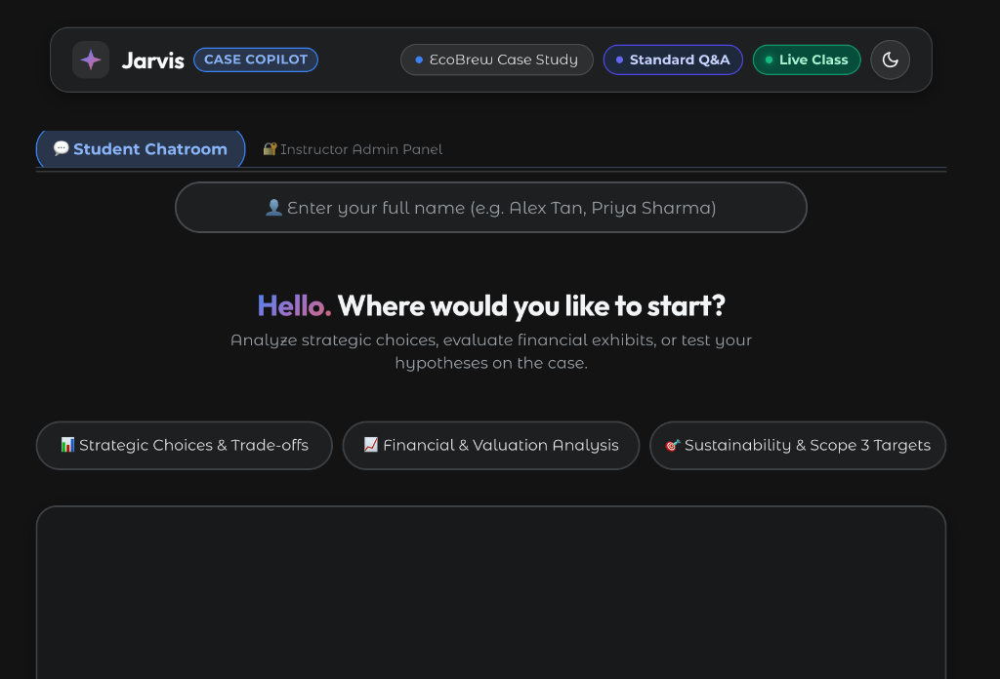
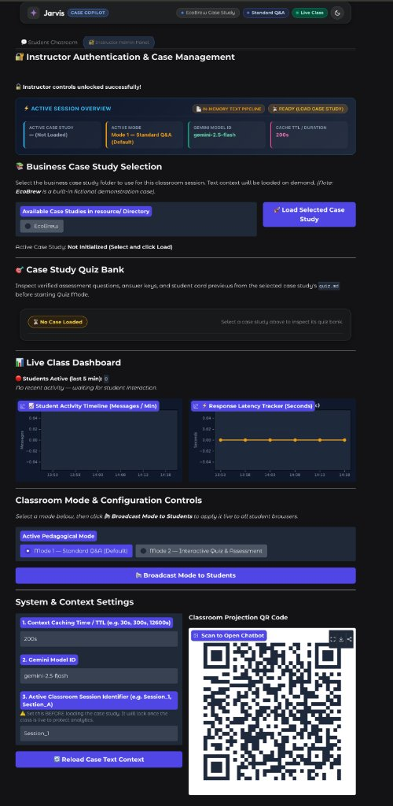

# Case-Room — an AI case study companion for your classroom

**Case-Room** gives every student in your class a personal AI teaching assistant, **Jarvis**, that answers questions using **only the case study you assign**. Students scan a QR code, type their name, and start asking questions from their phone or laptop. You control the session from a password-protected instructor panel, and after class you get a log of every question asked.

It was built for, and tested in, a live 3-hour business school session with about 50 students. You run it on your own laptop. There are no servers to rent and nothing for students to install.



---

## Why use it?

- **Grounded in your case.** Jarvis answers only from the documents you provide. If the case doesn't say something, Jarvis says so instead of making it up. Off-topic questions and "jailbreak" attempts are politely turned down.
- **Built for teaching.** Answers are short (under ~175 words) and usually end with a discussion question that pushes students to think instead of copy-pasting.
- **Two classroom modes.**
  - **Q&A mode** lets students explore the case freely.
  - **Quiz mode** runs a 5-question quiz that moves from recall to analysis (Bloom's taxonomy), with two attempts and a hint per question.
- **You stay in control.** With one click you can switch the whole class between modes, and you can watch live charts of student activity and response times.
- **Evidence for your debrief.** Every exchange is logged with the student's name and a timestamp, so you can see what the class asked about and where they struggled.
- **Low cost.** It uses Google's Gemini API. A free API key works for small groups and testing. For a full class, a pay-as-you-go key usually costs a few dollars per session.
- **Works with any case.** Drop your PDFs into a folder, run one command, and the case appears in the instructor panel.

<details>
<summary>📸 <strong>Click to preview the Instructor Admin Panel</strong></summary>

<p align="center">
  
</p>

</details>

---

## Quick start

> [!NOTE]
> **Never used a terminal before?** Follow the step-by-step **[Setup Guide](docs/SETUP_GUIDE.md)** instead. It assumes no coding experience and takes about 20 minutes.

If you are comfortable with a terminal:

```bash
# 1. Install uv (Python package manager) if you don't have it
curl -LsSf https://astral.sh/uv/install.sh | sh

# 2. Get the code and install dependencies
git clone https://github.com/<your-org>/case-room.git
cd case-room
uv sync

# 3. Add your Gemini API key (get one free at https://aistudio.google.com/apikey)
cp .env.example .env        # then edit .env and paste your key

# 4. Launch (works identically on macOS, Windows, and Linux)
uv run python src/chatbot.py
```

The terminal prints a public link (`https://xxxx.gradio.live`) and saves a QR code to `static/classroom_qr.png`. Open the link, go to **🔐 Instructor Admin Panel**, enter your password (`admin123` by default, configured in `.env`), press **Enter**, pick the case study, and click **🚀 Load Selected Case Study**. Your class is live.

---

## Documentation

| Guide | Use it for |
| :--- | :--- |
| 📘 **[Setup Guide](docs/SETUP_GUIDE.md)** | Installing Case-Room on a Mac or Windows computer, from nothing |
| 🧭 **[User Guide](docs/USER_GUIDE.md)** | A tour of every screen, running a live class, and what to do after class |
| 📚 **[Adding Your Own Case Study](docs/ADDING_A_CASE_STUDY.md)** | Loading your PDFs, adding exhibit data, and writing your own quiz |
| 🚑 **[Troubleshooting](docs/TROUBLESHOOTING.md)** | Fixes for common problems before and during class |
| 💻 **[Developer Guide](docs/developer/README.md)** | System architecture, interactive diagrams, ADRs, and testing protocols |

---

## What's included

The repository comes with a sample case, **EcoBrew: Sustainability & Global Strategy** (in `resource/EcoBrew/`), and a ready-made 5-question quiz for it. Use it to try the whole workflow before you add your own case.

> [!NOTE]
> **Fictional Case Study Notice:** **EcoBrew** is an entirely fictional, synthetic company and case study created solely for demonstration, automated testing, and benchmark evaluation. Any resemblance to actual companies, real-world operational/financial data, or living individuals is purely coincidental.

---

## Requirements at a glance

- A Mac, Windows, or Linux laptop that stays on and connected to the internet during class
- A Google Gemini API key ([free to create](https://aistudio.google.com/apikey))
- About 2 GB of free disk space
- Students need a phone or laptop with a web browser. They don't install anything or create accounts.

---

## Privacy note

Chat logs are stored **only on your laptop** in the `logs/` folder. They are never uploaded to GitHub, because the folder is excluded by `.gitignore`. Emails, phone numbers, and student ID numbers are automatically masked before they are written to the log. Student questions are sent to Google's Gemini API to generate answers, so check that this fits your institution's data policy before class.

---

## For developers

Case-Room is a Python 3.13 + [Gradio](https://www.gradio.app/) app that uses the [Google GenAI SDK](https://github.com/googleapis/python-genai).

- 📖 **[Developer & Architecture Guide](docs/developer/README.md)**: Deep dive into the system design, microkernel plugin protocol, Spec-Driven Development (SDD) workflow, and the 5-Level Testing Pyramid.
- 🏛️ **[Interactive Architecture Diagram](docs/developer/architecture.html)** & 🧪 **[Testing Pipeline Diagram](docs/developer/testing.html)**: Standalone explorable HTML diagrams with Semantic Passport and IDE jumping.
- 📐 **[Architecture Decision Records (ADR.md)](docs/developer/ADR.md)**: Formal records of design decisions and trade-offs.
- 📋 **[Release Notes & History (release.md)](docs/developer/release.md)**: Canonical release history, changelogs, and version milestones (v0.5.0–v0.8.0).

To run the routine unit tests:

```bash
uv run pytest tests/test_chatbot.py -v
```

Contributions are welcome. Please open an issue to discuss larger changes first.

---

## License & credits

Created by **Sukti Ghosh** and **Prithis Samaddar**.

Case-Room is licensed under the **[Apache License 2.0](LICENSE)**. See the **[NOTICE](NOTICE)** file for copyright notices and third-party acknowledgments. The included synthetic EcoBrew demonstration case is also provided under the Apache-2.0 license for testing and onboarding purposes.
