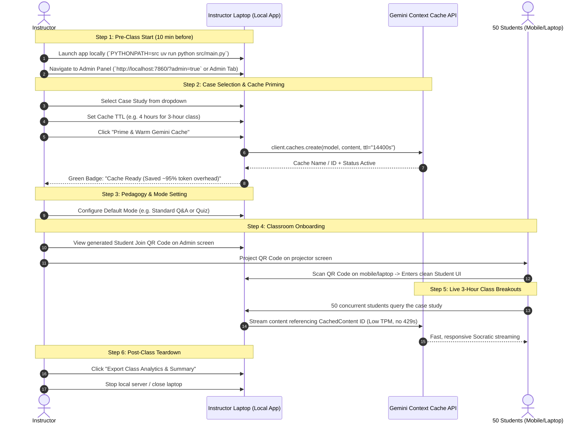

# Instructor Classroom Operating Workflow & Architecture Context

This document captures the exact operational pattern and requirements for using the Business Case Chatbot in a live classroom environment. Agents and contributors should reference this document for all future reviews, test setups, and architectural decisions.

---

## 1. Operating Profile & Context

- **Event Type**: Live 3-Hour Interactive Executive / MBA Classroom Workshop.
- **Audience**: ~50 Students using heterogeneous personal devices (macOS, Windows, iOS Safari, Android Chrome, iPadOS).
- **Host**: Single instructor laptop (macOS / Apple Silicon) running the server locally, closed and powered down immediately after class.
- **Access Model**: Students connect over classroom Wi-Fi or local network via a scanned QR code to the student UI.

---

## 2. Instructor Pre-Class & Live Workflow

---

## 3. Detailed Step-by-Step Operating Flow

### Step 1: Launch App
- Instructor starts the server on laptop before class (`PYTHONPATH=src uv run python src/main.py`).
- Terminal and launcher detect host LAN IP (`http://<LAN_IP>:7860`).

### Step 2: Access Admin Section
- Instructor opens the Admin interface (`?admin=true` or secure admin tab).
- Clean separation ensures students cannot see or fiddle with administrative controls.

### Step 3: Select Case & Warm Cache with TTL
- Select the active case file from available cases.
- Input desired TTL: Defaults to **4 hours** (`14400s`) to ensure uninterrupted coverage for the 3-hour class.
- Click **"Load Case into Gemini Cache"**:
  - The server reads the case text.
  - Calls Gemini API `client.caches.create(...)`.
  - Displays confirmed Cache Name/ID, expiry countdown, and token savings estimate (~95% reduction).
  - All subsequent student conversations automatically inherit this cached case context.

### Step 4: Set Class Mode
- Configure the default pedagogical mode for the room (e.g., *Standard Q&A* or *Interactive Quiz Assessment*).
- Newly connected student sessions immediately inherit this mode as their starting point.

### Step 5: Share QR Code with the Class
- Admin panel renders a high-contrast QR code pointing to the student URL (`http://<LAN_IP>:7860`).
- Instructor projects this QR code onto the main screen or lets students scan it from the front desk.
- Students scan and land directly in the responsive, student-only chat interface (mobile & laptop optimized).

### Step 6: Post-Class Shutdown
- Instructor exports session logs/summary CSV.
- Shuts down the process and closes the laptop.
