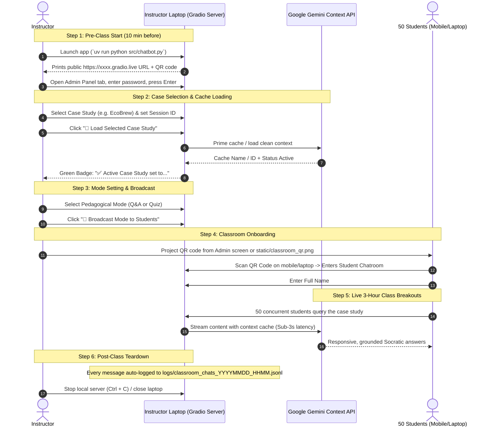

# Instructor Classroom Operating Workflow & Architecture Context

This document captures the exact operational pattern and requirements for using the Business Case Chatbot in a live classroom environment. Agents and contributors should reference this document for all future reviews, test setups, and architectural decisions.

---

## 1. Operating Profile & Context

- **Event Type**: Live 3-Hour Interactive Executive / MBA Classroom Workshop.
- **Audience**: ~50 Students using heterogeneous personal devices (macOS, Windows, iOS Safari, Android Chrome, iPadOS).
- **Host**: Single instructor laptop (macOS / Apple Silicon) running the server locally, closed and powered down immediately after class.
- **Access Model**: Students connect over classroom Wi-Fi or local network via a scanned QR code to the student UI.

---

## 2. Instructor Pre-Class & Live Workflow

---

## 3. Detailed Step-by-Step Operating Flow

### Step 1: Launch App
- Instructor starts the server on laptop before class (`uv run python src/chatbot.py`).
- Terminal verifies `GOOGLE_API_KEY`, spins up Gradio with a public tunnel, and prints `https://xxxx.gradio.live`.

### Step 2: Access Admin Section
- Instructor opens the `gradio.live` link in their browser.
- Switch to the **🔐 Instructor Admin Panel** tab.
- Type `ADMIN_PASSWORD` (default `admin123`, configured in `.env`) and **press Enter** to unlock controls.

### Step 3: Select Case & Load Context
- Set the **Active Classroom Session Identifier** (e.g., `Section_A` or `Week5_Tue`) before loading.
- Select the active case folder from **Available Case Studies**.
- Verify or adjust Cache TTL (default: **4 hours** / `14400s`).
- Click **🚀 Load Selected Case Study**:
  - The server loads preprocessed text context (or auto-extracts from PDFs).
  - Warmed Gemini cache handle is established with ~95% token savings.
  - Active session locks to protect log consistency.

### Step 4: Set Class Mode & Broadcast
- Select desired pedagogical mode:
  - **Mode 1 — Standard Q&A (Default)**
  - **Mode 2 — Interactive Quiz & Assessment**
- Click **📢 Broadcast Mode to Students**. All connected student screens instantly receive the mode update card (and Quiz Question #1 if Quiz mode).

### Step 5: Share QR Code with the Class
- Project the high-contrast QR code directly from the Admin Panel or open `static/classroom_qr.png`.
- Students scan with phone or laptop cameras, enter their **Full Name**, and begin asking questions.

### Step 6: Post-Class Shutdown
- Every student interaction, timestamp, latency, and reply is automatically written to `logs/classroom_chats_YYYYMMDD_HHMM.jsonl` with student PII redacted.
- Instructor stops the local server by pressing `Ctrl + C` in the terminal.
