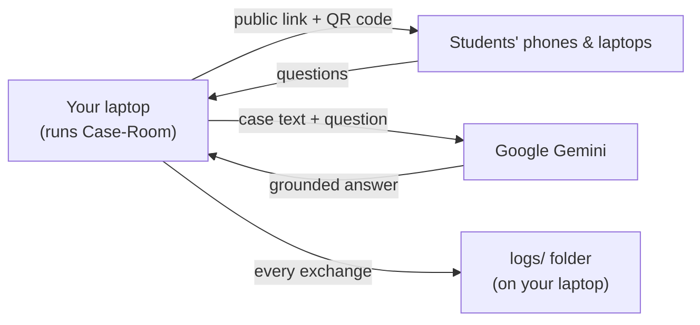
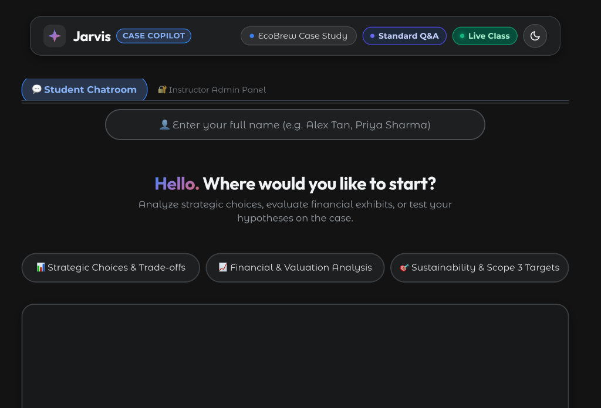
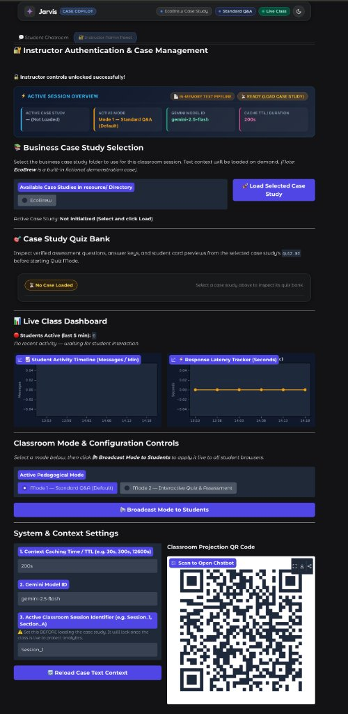

# User Guide

This guide walks through every screen in Case-Room and shows how to run a live class from start to finish. It assumes Case-Room is already installed. If it isn't, start with the **[Setup Guide](SETUP_GUIDE.md)**.

**Contents**
1. [How it fits together](#1-how-it-fits-together)
2. [The Student Chatroom](#2-the-student-chatroom)
3. [The Instructor Admin Panel](#3-the-instructor-admin-panel)
4. [Running a class, step by step](#4-running-a-class-step-by-step)
5. [After class: logs and reports](#5-after-class-logs-and-reports)
6. [Tips from real classes](#6-tips-from-real-classes)

---

## 1. How it fits together



- **Your laptop is the server.** It needs to stay on, awake, and online for the whole class.
- **Students and you open the same link.** It has two tabs: **💬 Student Chatroom**, for everyone, and **🔐 Instructor Admin Panel**, which needs your password. Students can see the admin tab, but they can't open it without the password.
- **Gemini sees only the case you load**, plus each student's question. That's what keeps answers grounded.

---

## 2. The Student Chatroom



This is the screen students see after scanning the QR code. It works on phones, tablets, and laptops.

| Element | What it does |
| :--- | :--- |
| **👤 Name box** (top) | Students **must enter their full name before asking anything**. If they skip it, they'll see *"⚠️ Student Name Required"*. The name is how you tell students apart in the logs. |
| **Greeting & starter buttons** | Three one-tap starter questions (📊 *Strategic Choices & Trade-offs*, 📈 *Financial & Valuation Analysis*, 🎯 *Sustainability & Scope 3 Targets*) help hesitant students get going. |
| **Chat area** | Jarvis's answers stream in here. In Q&A mode, most answers end with a **💡 Discussion Question**. |
| **Message box** (bottom) | Type a question and press Enter or the **↑** button. |
| **Announcement cards** | When you switch modes from the admin panel, a card appears in every student's chat within a few seconds. Nobody needs to refresh. |

### What students experience in each mode

**Mode 1: Standard Q&A (default)**
- Students ask anything about the case and get short, factual answers (under ~175 words) based only on the case documents.
- If the case doesn't contain the answer, Jarvis says so instead of guessing.
- If a student states something wrong ("EcoBrew hit all its targets, right?"), Jarvis politely corrects them instead of agreeing.
- If a student asks several questions at once, Jarvis answers the first and asks them to send one question at a time.
- Off-topic questions ("Who won the World Cup?") and attempts to trick the bot are politely turned down.

**Mode 2: Interactive Quiz & Assessment**
- Question 1 appears automatically in every student's chat as soon as you broadcast Quiz mode.
- The quiz has **5 questions** that build from recall to analysis. Multiple-choice options show as tappable buttons. For open-ended questions, students write an answer, and Jarvis grades it against your rubric points.
- **Two attempts per question:**
  - Correct on the first try: **1 point**
  - Wrong on the first try: Jarvis gives a **💡 Hint**
  - Correct on the second try: **0.5 points**
  - Wrong twice: Jarvis shows the correct answer, with an explanation, and moves on
- At the end, each student sees a **📊 Final Score** scorecard that lists the concepts they missed.

> [!WARNING]
> A student's quiz progress lives in their browser tab. **If they refresh or close the tab, their quiz restarts from Question 1.** Tell students before you start Quiz mode not to refresh.

---

## 3. The Instructor Admin Panel

Click the **🔐 Instructor Admin Panel** tab, type your password (the `ADMIN_PASSWORD` in your `.env` file), and press **Enter**. The password box disappears and the **⚙️ Instructor Control Center** opens. From top to bottom, it has these sections.

<details>
<summary>📸 <strong>Click to expand the full Instructor Admin Panel screenshot</strong></summary>

<p align="center">
  
</p>

</details>

### 3.1 Session overview banner

A dark summary card at the top that shows the current state at a glance:

| Item | Meaning |
| :--- | :--- |
| **● LIVE SESSION** / **⏳ READY (LOAD CASE STUDY)** | Green means a case is loaded and students can chat. Amber means you still need to load a case. |
| **⚡ GEMINI CACHE ACTIVE** / **📄 IN-MEMORY TEXT PIPELINE** | Shows whether Gemini is caching your case, which is faster and cheaper. Both work. The in-memory option is the automatic fallback, for example on free API keys. |
| **Active Case Study** | The case students are currently chatting about. |
| **Active Mode** | The live mode. If you've selected a different mode but not broadcast it yet, you'll see *"⏳ Staged: … — Click Broadcast"*. |
| **Model / Cache TTL** | The Gemini model and cache duration currently in use. |

### 3.2 📚 Business Case Study Selection

- **Available Case Studies**: one option for each folder inside `resource/` (including the built-in synthetic demonstration case, **EcoBrew**). To add your own, see **[Adding Your Own Case Study](ADDING_A_CASE_STUDY.md)**.
- **🚀 Load Selected Case Study**: loads the case into Jarvis. **Until you click this, students see *"⚠️ No Case Study Selected"*.**
- A confirmation like *"✅ Active Case Study set to: EcoBrew (Loaded 21,226 chars…)"* appears when it worked.
- If the case doesn't have its own quiz yet, you'll see a warning that Quiz mode will use AI-generated questions. See [writing a quiz bank](ADDING_A_CASE_STUDY.md#step-4-optional-write-a-quiz-for-the-case).

> [!NOTE]
> **EcoBrew** is a completely fictional case study included to verify your setup and test classroom dynamics before uploading course materials.

### 3.3 📊 Live Class Dashboard

Refreshes automatically every 10 seconds:

- **🟢 Students Active (last 5 min)**: how many different students have sent a message recently.
- **📈 Student Activity Timeline**: messages per minute over the last 30 minutes. Use it to see whether the room is engaged or has gone quiet.
- **⚡ Response Latency Tracker**: how many seconds Jarvis takes to answer. Normally 1.5–3.5 seconds. Spikes usually mean many students sent questions at the same moment.

### 3.4 Classroom Mode & Configuration Controls

Changing modes takes **two steps**, so you can't switch the class by accident:

1. Select a mode under **Active Pedagogical Mode**:
   - **Mode 1 — Standard Q&A (Default)**
   - **Mode 2 — Interactive Quiz & Assessment**
2. Click **📢 Broadcast Mode to Students**. Within a few seconds every student gets an announcement card, and in Quiz mode they also get Question 1.

Selecting a mode on its own does **nothing** for students until you broadcast it.

### 3.5 System & Context Settings

| Setting | When to change it |
| :--- | :--- |
| **1. Context Caching Time / TTL** | How long Gemini keeps your case cached. Set it longer than your class, e.g. `14400s` (4 hours) for a 3-hour session. Change it **before** loading the case. |
| **2. Gemini Model ID** | Normally leave as `gemini-2.5-flash`. |
| **3. Active Classroom Session Identifier** | A label saved with every log entry, e.g. `Section_A` or `Week5_Tue`. **Set it before you click Load**, because it locks once the class is live so your logs stay consistent. |
| **🔄 Reload Case Text Context** | Re-reads the case files from disk. Use it if you edited the case files while the app was running. |
| **Classroom Projection QR Code** | The QR code students scan. Put it on the projector. The same image is saved at `static/classroom_qr.png`. |

---

## 4. Running a class, step by step

### Before class (10–15 minutes ahead)

1. **Plug in your laptop** and turn off sleep. On a Mac, use *System Settings → Battery/Energy → Prevent automatic sleeping*. On Windows, use *Settings → Power → Screen and sleep → Never*.
2. **Start Case-Room** (see [Setup Guide step 9](SETUP_GUIDE.md#9-starting-it-again-next-time)) and open the `gradio.live` link it prints.
3. **Open the 🔐 Instructor Admin Panel** and unlock it.
4. **Set the Session Identifier** (e.g. `Section_A`) and check that **TTL** covers the whole class.
5. **Select your case** and click **🚀 Load Selected Case Study**. Wait for the ✅ message.
6. **Test it yourself.** In the Student Chatroom, enter your name and ask one question.
7. Keep **[Troubleshooting](TROUBLESHOOTING.md)** open in another browser tab, just in case.

### Starting class

1. **Project the QR code** from the admin panel, or open `static/classroom_qr.png`.
2. Tell students: *"Scan the code, enter your **full name** at the top, then ask Jarvis anything about the case."*
3. Watch **🟢 Students Active** go up on the dashboard.

### During class

- **Free exploration:** stay in **Q&A mode**. It works well for breakout groups preparing arguments.
- **Check understanding:** select **Quiz mode**, then **📢 Broadcast**. Remind students not to refresh during the quiz.
- **Back to discussion:** select **Q&A mode**, then **📢 Broadcast** again.
- Glance at the **Activity Timeline** to see when energy drops, and the **Latency Tracker** to make sure answers are coming back quickly.

> [!TIP]
> Avoid synchronised moments like *"Everyone send your question… now!"* Fifty questions arriving in the same second can slow answers down for 15–20 seconds. Let questions trickle in over a couple of minutes.

### After class

1. Press `Ctrl + C` in the terminal to stop Case-Room.
2. Your class log is already saved. See the next section.

---

## 5. After class: logs and reports

### Where the logs are

Every student message and Jarvis reply is saved automatically, as it happens, to:

```text
case-room/logs/classroom_chats_YYYYMMDD_HHMM.jsonl
```

The file name is the date and time you **started** Case-Room, e.g. `classroom_chats_20261111_0900.jsonl`. Each line is one exchange and records:

- timestamp, session identifier, and case study
- student name and how many turns into the conversation they were
- mode (Q&A or quiz)
- the question and Jarvis's answer
- how long the answer took

Files starting with `test_` come from automated tests, not your class. You can ignore or delete them.

> [!NOTE]
> Emails, phone numbers, and student ID numbers are automatically masked (e.g. `{{STUDENT_ID}}`) before anything is written. The `logs/` folder is never uploaded to GitHub.

### Opening a log without coding

`.jsonl` files are plain text. A quick way to read one as a spreadsheet:

1. Open **Excel → Data → Get Data → From File → From JSON**. Choose *All files* in the file picker so you can select the `.jsonl` file. Power Query turns each line into a row.
2. Or open the file in any text editor to skim the conversations and review student engagement directly.

---

## 6. Tips from real classes

- **Have students enter real full names.** It makes the logs much more useful for participation tracking.
- **Run a 2-minute warm-up.** Ask everyone to try one starter button first, so you can find connection problems before the real activity.
- **Use Quiz mode as an exit ticket.** Broadcast it in the last 15 minutes. The scorecards tell students what to review.
- **Write your own quiz.** The AI-generated fallback works, but a hand-written quiz bank ([how-to](ADDING_A_CASE_STUDY.md#step-4-optional-write-a-quiz-for-the-case)) gives you exact control over what's assessed.
- **Use a new Session Identifier for each section** if you teach the same case more than once, so their logs are easy to tell apart.
